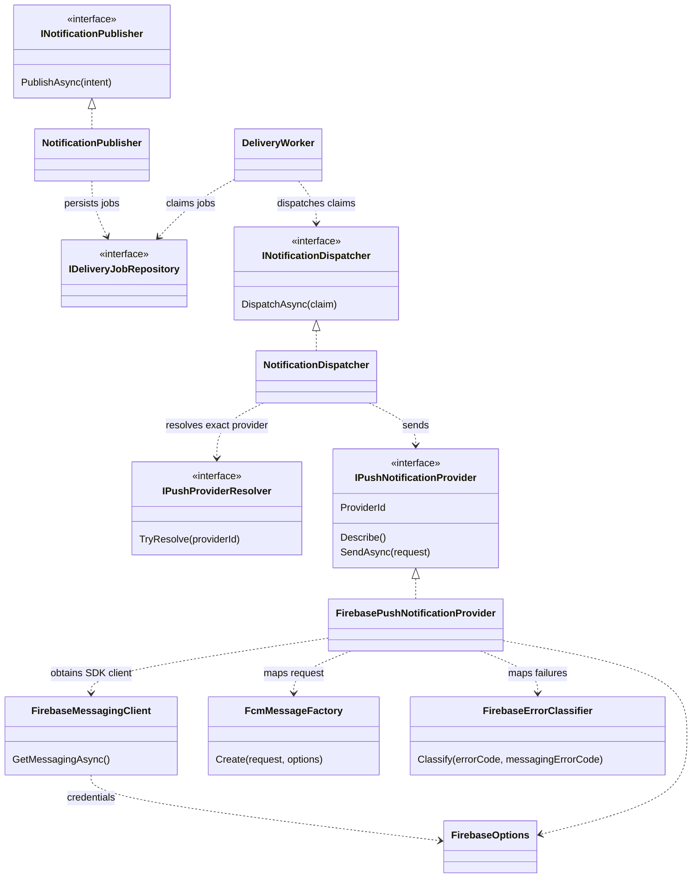
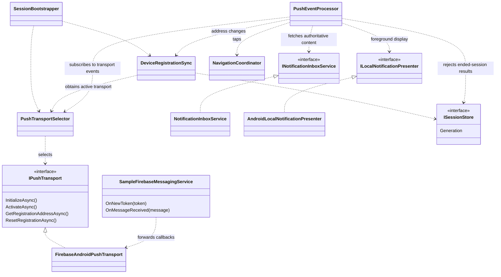

# Firebase Cloud Messaging: from registration to read state

This guide is for an intermediate-to-advanced .NET developer who knows ASP.NET Core, Clean Architecture, DI, and ports/adapters but is new to Firebase. It traces the current implementation; it does not require learning Firebase Authentication, Firestore, or Realtime Database, which this project does not use.

Read the [root setup guide](../README.md#quick-start-no-firebase-needed), then this guide, then the [Android setup instructions](../src/SampleMobile.Mobile/README.md#firebase-setup). Keep the [API contract](mobile-api-contract.md) available for request/response details and [architecture](architecture.md) for persistence and worker mechanics.

## The Firebase concepts you need

| Concept | Meaning in this project | Do not confuse it with |
|---|---|---|
| Firebase project | Shared Google project used by the backend sender and Android app. | A .NET project or the application's user database. |
| Android app registration | Firebase configuration for package `xyz.kiaranet.samplemobile`. | Registering a signed-in user's device with our API. |
| `google-services.json` | Android client configuration compiled into resources; placed under `Platforms/Android/`. Rebuild after changing it. | The backend service-account private key. |
| Service-account credentials | Backend credentials used by Firebase Admin SDK to authenticate sends. Keep them outside the repository and device app. | The mobile API's JWT. |
| FCM registration token | Provider-issued delivery address for an app instance. It can rotate. This repository's `fcm` provider targets this address. | User identity, an API access token, or the app-owned installation ID. |
| `installationId` | GUID persisted by our app in Preferences, stable until app data is removed. | An FCM token or Firebase Installation ID (FID). |
| Mobile JWT | Issued by our ASP.NET Core backend; authenticates registration and inbox requests. | Firebase Authentication, which is not used. |
| Notification channel | Android OS category controlling notification presentation; the app creates `sample_mobile_default`. | An FCM topic or backend notification type. |
| Notification versus data payload | `notification` supplies title/body for automatic background display; `data` carries routing identifiers. | A single callback path that runs in every app state. |

The backend never obtains a device token on the phone's behalf. The Android SDK obtains it; the signed-in app posts it to our API. A send then has two separate network legs: backend → FCM, and FCM → device. The inbox remains available even if the second leg never happens.

## 1. Sign in and register a delivery address

This sequence shows successful FCM selection. Without client configuration or Google Play services, the selector uses inbox-only mode instead. A temporary FCM network failure does not switch an existing FCM transport to the simulator.

```mermaid
sequenceDiagram
    autonumber
    actor User
    participant Session as SessionService
    participant API as ASP.NET Core mobile API
    participant Boot as SessionBootstrapper
    participant Transport as FirebaseAndroidPushTransport
    participant SDK as Android Firebase SDK
    participant Sync as DeviceRegistrationSync
    participant DB as PostgreSQL
    User->>Session: Sign in
    Session->>API: POST /api/mobile/auth/login
    API-->>Session: JWT and expiry
    Session->>Session: Store session securely
    Session->>Boot: RunAsync(Login), asynchronously
    Boot->>Sync: Process pending old-session cleanup first
    Boot->>Transport: Select, initialize, activate
    Transport->>SDK: Enable auto-init
    Boot->>Boot: Get stable installationId; request permission
    Note over Boot,SDK: Registration does not wait for notification permission
    Boot->>Transport: GetRegistrationAddressAsync
    Transport->>SDK: GetToken
    SDK-->>Transport: FCM registration token
    Transport-->>Boot: Address
    Boot->>Sync: Persist address, then SyncAsync
    Sync->>API: POST /api/mobile/device-registrations with JWT
    API->>DB: Upsert by installationId and provider
    Note over API,DB: Owner comes from authenticated user; address is not returned
    DB-->>API: Saved
    API-->>Sync: 201 created or 200 refreshed
    Boot->>API: Refresh inbox through inbox service
    opt Token rotates later
        SDK->>Transport: OnNewToken via SampleFirebaseMessagingService
        Transport->>Sync: AddressChanged via PushEventProcessor
        Sync->>Sync: Persist latest address
        Sync->>API: Re-register when signed in
    end
```

The API accepts a supported provider even if its server credentials are missing: **registered** means an address was saved, not that sending works. Likewise, the dashboard's **Configured** status checks configuration presence; credentials are initialized lazily on the first send. `ValidateOnly` validates through FCM but does not deliver to the phone.

Source: [SessionBootstrapper](../src/SampleMobile.Mobile.Core/Session/SessionBootstrapper.cs), [DeviceRegistrationSync](../src/SampleMobile.Mobile.Core/Push/DeviceRegistrationSync.cs), [RegisterDeviceCommandHandler](../src/SampleMobile.Application/Features/Devices/RegisterDevice.cs), [FirebaseMessagingClient](../src/SampleMobile.Infrastructure/Push/Firebase/FirebaseMessagingClient.cs).

## 2. Persist a notification, then send through FCM

Direct compose and domain-event publication converge on the same publisher. The outbox is needed for the business-event path; direct compose does not manufacture a domain event just to send a notification.

```mermaid
sequenceDiagram
    autonumber
    participant Entry as Dashboard use case
    participant DB as PostgreSQL
    participant Outbox as OutboxProcessor and event handler
    participant Publisher as NotificationPublisher
    participant Worker as DeliveryWorker
    participant Dispatcher as NotificationDispatcher
    participant Provider as FirebasePushNotificationProvider
    participant FCM as Firebase Cloud Messaging
    alt Direct compose
        Entry->>Publisher: SendNotificationCommand handler publishes intent
    else DemoAlert business event
        Entry->>DB: Commit DemoAlert and outbox event together
        Outbox->>DB: Lock due outbox row in transaction
        Outbox->>Publisher: Publish intent with event deduplication key
    end
    Publisher->>DB: Save notification, recipients, and delivery jobs
    Note over Publisher,DB: Event path joins the outbox transaction
    opt Event path
        Outbox->>DB: Mark event processed and commit transaction
    end
    DB-->>Worker: Work notification through listener, or timed wake-up
    Worker->>DB: Claim due jobs; create attempt and lease; commit
    Worker->>Dispatcher: DispatchAsync(claim) in its own DI scope
    Dispatcher->>DB: Load job, enabled registration, and content
    Dispatcher->>Provider: Resolve exact provider; SendAsync(request)
    Provider->>Provider: Get Admin SDK client; build FCM message
    Note over Provider,FCM: Provider call runs outside the claim transaction
    Provider->>FCM: Admin SDK SendAsync (HTTP v1)
    FCM-->>Provider: Message ID or error
    Provider-->>Dispatcher: Normalized PushDispatchResult
    Dispatcher->>DB: Save outcome, attempt, and any retry/device change
    Note over DB,FCM: ProviderAccepted does not mean delivered, displayed, or read
```

The `notification` block contains the canonical title/body copied at send time. The `data` block contains `notificationId`, `type`, and optional `resourceId`; metadata is not copied into it. The backend targets `Message.Token`, sets Android high priority and the notification tag, and optionally sets a channel ID.

Source: [NotificationPublisher](../src/SampleMobile.Application/Services/NotificationPublisher.cs), [OutboxProcessor](../src/SampleMobile.Infrastructure/BackgroundServices/OutboxProcessor.cs), [DeliveryWorker](../src/SampleMobile.Infrastructure/BackgroundServices/DeliveryWorker.cs), [NotificationDispatcher](../src/SampleMobile.Application/Services/NotificationDispatcher.cs), [FcmMessageFactory](../src/SampleMobile.Infrastructure/Push/Firebase/FcmMessageFactory.cs).

## 3. Receive, display, tap, and mark read

The app-controlled UI fetches authoritative content from the API. **Android's automatic background tray display is an exception:** it uses the FCM notification payload before our API authorization or session-generation checks can run. This distinction matters on a shared device and during delayed delivery or offline logout. A later `404` protects the detail fetch; it cannot undo text already displayed by the OS.

```mermaid
sequenceDiagram
    autonumber
    participant FCM as FCM and Android SDK
    participant Service as SampleFirebaseMessagingService
    participant Transport as FirebaseAndroidPushTransport
    participant Processor as PushEventProcessor
    participant Inbox as NotificationInboxService
    participant API as Mobile notifications API
    participant Tray as Android notification tray
    participant Nav as MainActivity and NavigationCoordinator
    participant Detail as NotificationDetailViewModel
    alt App in foreground
        FCM->>Service: OnMessageReceived
        Service->>Transport: Forward RemoteMessage
        Transport->>Processor: MessageReceived with data, dropping payload text
        Processor->>Processor: Check session, transport, and recent/in-flight IDs
        Processor->>Inbox: ApplyPushHintAsync(notificationId)
        Inbox->>API: GET /api/mobile/notifications/{id} with JWT
        API-->>Inbox: Content or failure
        Inbox-->>Processor: Fetch outcome
        Processor->>Processor: Check session generation again
        alt Found, unread, and session unchanged
            Processor->>Tray: Local presenter shows API content
        else Transient fetch failure with valid ID
            Processor->>Tray: Content-free generic notification
        else 404 or session ended
            Note over Processor,Tray: Do not show notification content
        end
    else Background or normally terminated
        FCM->>Tray: Automatically display notification payload
        Note over Service,Tray: No OnMessageReceived callback for this mixed payload
    end
    Tray->>Nav: User taps; notificationId arrives in intent extras
    Note over Nav,Detail: Wait for restored/login session and ready shell if needed
    Nav->>Detail: Open notification detail
    Detail->>Inbox: GetAsync(id)
    Inbox->>API: GET /api/mobile/notifications/{id}
    API-->>Detail: Authorized content through inbox service
    opt Fetch succeeds and notification is unread
        Detail->>Inbox: MarkAsReadAsync(id)
        Inbox->>API: POST /api/mobile/notifications/{id}/read
        API-->>Detail: Updated per-user read state through inbox service
    end
```

The last two response arrows abbreviate the return through `NotificationInboxService`. Malformed tap IDs open the inbox instead. Already-read messages update the inbox without another local notification. Recent-ID deduplication is an in-memory, bounded cache (200 IDs), not a durable exactly-once guarantee.

Android foreground/background behavior is documented in [Firebase's receiving guide](https://firebase.google.com/docs/cloud-messaging/android/receive-messages). Source: [PushEventProcessor](../src/SampleMobile.Mobile.Core/Push/PushEventProcessor.cs), [NotificationTapIntents](../src/SampleMobile.Mobile/Platforms/Android/Notifications/NotificationTapIntents.cs), [NavigationCoordinator](../src/SampleMobile.Mobile.Core/Navigation/NavigationCoordinator.cs), [NotificationDetailViewModel](../src/SampleMobile.Mobile.Core/ViewModels/NotificationDetailViewModel.cs).

## 4. Logout and offline cleanup

This is the implemented lifecycle, including the durable cleanup omitted from the API contract's simplified logout sketch. Registration POST and cleanup DELETE are serialized by `DeviceRegistrationSync`.

```mermaid
sequenceDiagram
    autonumber
    participant Session as SessionService
    participant Sync as DeviceRegistrationSync
    participant Store as Local secure cleanup state
    participant API as Device registrations API
    participant Transport as FirebaseAndroidPushTransport
    Session->>Sync: BeginLogoutAsync(current session)
    Sync->>Store: Persist cleanup with old JWT and expiry
    Session->>Session: Sign out; clear inbox, navigation, and tray
    Session->>Sync: ProcessPendingCleanupAsync
    opt Saved JWT has not expired
        Sync->>API: DELETE installation registration using saved JWT
        API-->>Sync: Result; retain DELETE on transient failure
    end
    Sync->>Transport: ResetRegistrationAsync
    Transport->>Transport: Disable auto-init and delete FCM token
    Sync->>Store: Retain unfinished cleanup for later retry
    Note over Sync,Transport: Token reset is attempted even if DELETE failed transiently
    Note over Session,Store: Resume, reconnect, or next launch retries pending cleanup
```

Expired saved JWTs cannot authenticate DELETE, so that part is dropped; provider token reset remains pending until it succeeds. A new login processes old cleanup before obtaining/registering its address. Successful registration supersedes older cleanup for the same installation/provider. Do not equate local logout with instantaneous revocation of every queued push.

## 5. Class map: server adapter and mobile adapter

These diagrams show selected real types and dependencies, not every constructor argument. Dashed arrows mean use/call dependencies; hollow triangles mean interface implementation. They are two separate processes connected by HTTP and FCM, not project references between mobile and backend.



`DeliveryWorker` and the Firebase classes live in Infrastructure. The publisher, dispatcher, resolver port, provider port, and repository port live in Application. DI registers the concrete adapter; application use cases never name Firebase SDK types.



Only the three Android-specific concrete classes in this diagram belong to the MAUI Android project. The transport interface and orchestration live in Mobile.Core. Android callbacks enter the Core workflow as provider-neutral events.

## Failure semantics and a practical debugging route

| Observation | Meaning and next check |
|---|---|
| No notification in the API inbox | Investigate publication/recipient selection or outbox processing before Firebase. |
| Inbox item but no delivery job | Check selected registrations; an empty target list is intentionally inbox-only. |
| Job stays pending | Check worker enablement, due time, lease, and database connectivity. |
| `firebase_not_configured` or credential/authentication failure | Fix server configuration, then requeue. The device is not disabled for these failures. |
| Transient FCM failure | Dispatcher schedules bounded backoff, honoring a longer `Retry-After`; retry exhaustion fails the job. |
| `fcm_unregistered` | Explicit invalid-address response; job fails and registration is disabled. |
| `ProviderAccepted` but no tray entry | Check validate-only mode, actual device token/project, Android app state, permission/channel settings, and device connectivity. Acceptance is not a receipt. |
| Tray entry but detail unavailable | Check API reachability, JWT/session, and recipient ownership; another user's notification returns `404`. |

Correlate the backend notification ID with delivery job/attempt history and the mobile Diagnostics event. Follow [the Android manual checklist](../src/SampleMobile.Mobile/README.md#manual-android-test-checklist) for device verification. A simulated send exercises backend processing; it does not test the FCM network or Android callbacks.

At-least-once sending permits a duplicate when the process crashes after FCM acceptance but before saving the result. The Android tag supports tray replacement, and the inbox is keyed by notification ID. Do not treat `collapse_key` as an exactly-once mechanism: Firebase documents that notification messages ignore it, and collapsible-message storage has a four-key limit. The factory sets it, but correctness must come from persisted inbox state and refresh. See [Firebase collapse semantics](https://firebase.google.com/docs/cloud-messaging/customize-messages/collapsible-message-types).

## Setup checkpoints

Use the [backend setup](../README.md#firebase-setup-real-android-pushes) for server credentials and the [Android setup](../src/SampleMobile.Mobile/README.md#firebase-setup) for client configuration. Those sections own the setup commands; this table explains how to interpret progress.

| Checkpoint | Evidence | What it does not establish |
|---|---|---|
| Client configured | Matching Android package and Firebase project in compiled client configuration; transport selected as FCM. | A valid signed-in user or backend registration. |
| Server configured | Overview lists FCM as Configured. | Credential validity; initialization is lazy. |
| Device registered | Home says Registered and dashboard shows its installation/provider. | Server can send, or notification permission is granted. |
| Provider accepted | Delivery attempt has an FCM message ID. | Device receipt/display; `validate-only:` explicitly means no delivery. |
| Device displayed | Observe a tray/local notification on the device. | Detail authorization or read state. |
| Read recorded | API response for this user has a non-null `readAt`. | A general FCM delivery receipt; users can open inbox items without a push. |

## Trace one notification end to end

This is a reproducible learning exercise, not a report of a live test run. Values below are illustrative and contain no credentials. Use the IDs from your own run; never capture full JWTs, service-account keys, or registration tokens in shared notes.

### A. Establish the provider-neutral baseline

Run the [quick start](../README.md#quick-start-no-firebase-needed). Compose a uniquely titled message such as `Learning trace A` for Alice's simulated registration. Confirm the inbox item exists and its delivery job becomes Provider accepted with Simulated indicated. This proves publication, persistence, job dispatch, and simulator execution. It proves nothing about Firebase or Android.

### B. Follow one real foreground send

Configure both sides from the same Firebase project, disable `Firebase:ValidateOnly`, sign in as Alice on Android, and allow notifications. Keep the app foregrounded. Compose `Learning trace B`, selecting only that Android FCM registration so there is one delivery job to follow.

1. Use the authenticated inbox API (the [PowerShell walkthrough](mobile-api-contract.md#powershell-walkthrough) or HTTP harness) to find that unique title and record its full `id`. The backend publisher also logs the notification ID and number of jobs created.
2. Open `/deliveries?NotificationId=<your-id>` on the signed-in admin dashboard. Open the matching job; its URL contains the full job ID. Check provider, installation, status, attempt number, and provider message ID.
3. On Android, inspect Debug **Diagnostics**: the last push event should refer to the same notification ID. For a fresh unread message successfully fetched and presented in the foreground, the outcome is `Presented`. The foreground callback is `SampleFirebaseMessagingService.OnMessageReceived`; set a debugger breakpoint there if you want to observe the SDK boundary directly.
4. Fetch that notification from the API before opening its detail: `readAt` should still be null. A received or displayed push does not mark it read.
5. Tap the notification. The detail view fetches authorized content and requests mark-read. Re-fetch from the API: `readAt` should now be non-null. Repeat mark-read and confirm the timestamp stays unchanged.

An illustrative correlation record looks like this (labels summarize observations, not literal log output):

```text
Title: Learning trace B
Notification ID: 01a137b2-10b3-7eb7-a480-92b0b0848c5c
Delivery job ID: <job UUID from dashboard URL>
Attempt: 1, provider=fcm, status=ProviderAccepted
Provider message ID: <FCM message ID, without validate-only prefix>
Mobile last event: Received, same notification ID, Presented
API before opening: readAt=null
API after opening: readAt=<UTC timestamp>
```

If the inbox item is absent, investigate publication or recipients. If the job fails, inspect the attempt's error code before touching the Android client. If accepted but no mobile event appears, check validate-only, the selected registration/project, and app state. A `PresentedGeneric` outcome means the foreground fetch failed transiently; a `NotFound` means the API did not authorize/find that ID. A denied permission or channel setting can prevent visible presentation even when processing ran.

### C. Change only the Android app state

Press Home and send a new uniquely titled message. Expect automatic background tray display; do not expect a foreground `Received` event. Tap it and inspect the `Opened` event and API read state. This demonstrates why notification payload text and app-fetched detail are different stages. If no tray entry appears, check Android permission/channel settings and delivery conditions; backend acceptance alone cannot establish the cause.

### D. Observe recovery without assuming replay

Keep the backend online, put the device in airplane mode, and send another message. The backend may still report Provider accepted. Reconnect and resume the app: verify the newest inbox page contains the message even if no delayed push arrives. TTL, collapsing, and device conditions can prevent a particular push from being delivered. To study backend retries deterministically, use the simulator's transient-failure scenario; it does not model all FCM failures.

### E. Distinguish invalid registration from configuration failure

First use the simulator's invalid-registration scenario to observe a failed job and a disabled registration. For an optional real-FCM check, follow the root README's uninstall/clear-data check using a disposable test installation and its old registration. FCM may take time to return `UNREGISTERED`; until that response is observed, do not mark invalidation as verified. Missing credentials or a project mismatch should fail the job without disabling the device. Inspect the error code and correct configuration before requeueing.

## POC limits and operational boundaries

| Boundary | Current behavior and implication |
|---|---|
| Inbox history | [NotificationInboxService](../src/SampleMobile.Mobile.Core/Notifications/NotificationInboxService.cs) refreshes the first 50 items. The API supports paging, but the shipped mobile list does not load all history. A direct ID fetch can retrieve an authorized older item. |
| Delivery guarantees | Provider acceptance is not device receipt. There is no delivery-receipt endpoint, and sends can duplicate after crashes. Read state is a separate user action. |
| Display and privacy | Background notification text is displayed by Android before the app's API/session checks. Offline logout cannot recall queued payloads. Sensitive-content policies need additional product/design decisions before production use. |
| Duplicate handling | Recent-ID tracking is bounded and in memory; tray replacement and backend inbox identity solve different problems. None provides exactly-once display. |
| Notification presentation | Permission, channel settings, connectivity, OS restrictions, and app state matter. High priority is not a promise of heads-up display. |
| Authentication | No refresh tokens. JWT expiry requires sign-in; cleanup cannot use an expired saved JWT for DELETE. |
| Outbox recovery | [OutboxProcessor](../src/SampleMobile.Infrastructure/BackgroundServices/OutboxProcessor.cs) retries pending events, then marks exhausted/unknown events failed. The delivery-job Requeue button does not requeue outbox events. There is no documented automated failed-outbox recovery workflow. |

For optional operational exploration, begin read-only: inspect Overview outbox counters, processor logs, and `notification.outbox_messages` fields `id`, `event_type`, `status`, `attempt_count`, and `last_error` through pgAdmin. Do not confuse an event failure before publication with a delivery failure after publication. Preserve the event ID/deduplication identity when designing recovery; manual row edits or republishing with a new event ID can change semantics.

Before adapting this POC to production, design and validate credential/key rotation, hosting and migrations, backup/restore, retention, failed-outbox replay tooling, and alerts for backlog/failures. The sample is not a production operations runbook. Changes to bound credentials should be followed by an appropriate service restart/redeployment and a controlled send; the existing Firebase client is cached after initialization. Real device testing remains necessary even when Core tests pass.

## Read the implementation in this order

1. [FcmMessageFactory](../src/SampleMobile.Infrastructure/Push/Firebase/FcmMessageFactory.cs): the actual wire-message shape.
2. [FirebasePushNotificationProvider](../src/SampleMobile.Infrastructure/Push/Firebase/FirebasePushNotificationProvider.cs) and [FirebaseErrorClassifier](../src/SampleMobile.Infrastructure/Push/Firebase/FirebaseErrorClassifier.cs): sending and error translation.
3. [FirebaseAndroidPushTransport](../src/SampleMobile.Mobile/Platforms/Android/Push/Firebase/FirebaseAndroidPushTransport.cs) and [SampleFirebaseMessagingService](../src/SampleMobile.Mobile/Platforms/Android/Push/Firebase/SampleFirebaseMessagingService.cs): SDK callbacks and token lifecycle.
4. [PushEventProcessor](../src/SampleMobile.Mobile.Core/Push/PushEventProcessor.cs): fetch, deduplicate, and display decisions.
5. [DeviceRegistrationSync](../src/SampleMobile.Mobile.Core/Push/DeviceRegistrationSync.cs): registration serialization, retries, and logout cleanup.

For executable examples, inspect [Firebase adapter tests](../tests/SampleMobile.Tests/Infrastructure/FirebaseAdapterTests.cs), [dispatcher tests](../tests/SampleMobile.Tests/Application/NotificationDispatcherTests.cs), [push processor tests](../tests/SampleMobile.Mobile.Tests/Push/PushEventProcessorTests.cs), and [registration sync tests](../tests/SampleMobile.Mobile.Tests/Push/DeviceRegistrationSyncTests.cs). These explain local behavior; they do not establish real FCM/device delivery.
